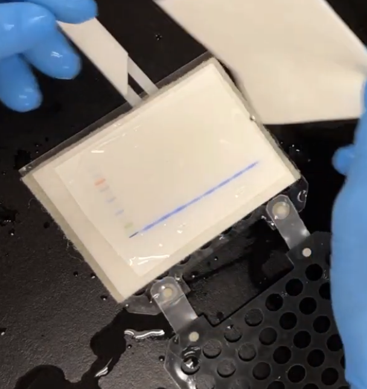
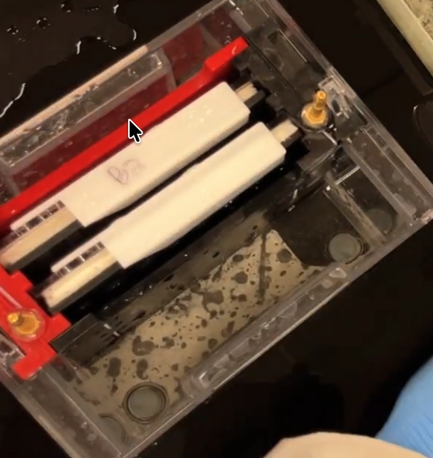

## Overview
Separate proteins by size (SDS-PAGE) → transfer to PVDF → probe with antibodies → image by chemiluminescence.

**Mechanism:** Sodium dodecyl sulfate (SDS) denatures proteins and gives them uniform negative charge, so migration depends only on molecular weight. 
**Optimized for PTPRB** — large, heavily glycosylated, low abundance. Settings marked ⚠️ are PTPRB-specific; use standard values for normal targets.

**Estimated timeline:**

| Stage                                                      | Time                           |
| ---------------------------------------------------------- | ------------------------------ |
| Sample preparation (lysis)                                 | ~30–45 min                     |
| Gel electrophoresis                                        | ~1–1.25 h                      |
| Transfer                                                   | ⚠️ 1.5 h (standard: 30–45 min) |
| Blocking                                                   | 1 h                            |
| Primary antibody                                           | 1 h (RT) or overnight (4°C)    |
| Washes + secondary antibody                                | ~1.5–2 h                       |
| Detection/imaging                                          | ~15 min - 1h                   |

**Equipment needed (not consumed):** SDS-PAGE gel tank and power supply, transfer apparatus (wet), PCR machine or heat block, tabletop centrifuge, sonicator, rocking platform, chemiluminescence imager, 

**Safety notes:**
- BME (2-mercaptoethanol) is a flammable, foul-smelling reducing agent — handle in a fume hood and keep in the flammable cabinet.
- Methanol (used for PVDF activation and in transfer buffer) is toxic and flammable — use in a ventilated area.
- SDS and acrylamide gels are irritants.

## Materials and Preparation

| Reagent                                 | Cat#                                                                                                                           | Storage                                                                |
| --------------------------------------- | ------------------------------------------------------------------------------------------------------------------------------ | ---------------------------------------------------------------------- |
| Cell lysis buffer                       | # 9803S                                                                                                                        | Aliquoted in small tubes, -20 storage room                             |
| Protease inhibitor                      | # PPC1010-1ML                                                                                                                  | -20°C, aliquoted                                                       |
| TGX gel                                 | #4561095                                                                                                                       | 4°C fridge B, storage room, on the door                                |
| Laemmli sample buffer                   | #1610737                                                                                                                       | DNA gel bench shelf                                                    |
| 2-mercaptoethanol (BME)                 | # M3148-25mL                                                                                                                   | Flammable cabinet                                                      |
| Protein ladder (up to 250 kDa)          | #1610374 [ladder ](https://www.bio-rad.com/en-us/sku/1610374-precision-plus-protein-dual-color-standards-500-ul?ID=1610374) | -20°C fridge B storage room                                            |
| 10x Running buffer                      | #1610732                                                                                                                       | DNA gel bench shelf (double check cat# since there are similar buffer) |
| PVDF membrane 0.2µm for normal proteins | #1212781 (⚠️**0.45 µm**)  # T13087                                                                                          | DNA gel bench shelf #1620174 needs methanol socking up              |
| Filter paper                            | #88600                                                                                                                         | DNA gel bench shelf                                                    |
| TBST                                    | # 9997S (or prepare, see below)                                                                                                | Stock without tween20 on my shelf                                      |
| 10 x Transfer Buffer                    | #1610734                                                                                                                       | DNA gel bench shelf                                                    |
| SuperSignal West Femto                  | #34094                                                                                                                         | 4°C; Zhang lab is more gentle                                          |
| milk powder                             | #30620074                                                                                                                      | chemical shelf                                                         |

**Antibody needed based on experiment**

| Antibody            | Cat#              | Dilution                    | Storage  |
| ------------------- | ----------------- | --------------------------- | -------- |
| Anti-PTPRB (rabbit) | PA568309          | 1:1000                      | –20 °C   |
| Anti-rabbit-HRP     | 32460             | 1:2000 ⚠️ (standard 1:5000) | 4 °C     |
| Anti-GAPDH (rat)    | Zhang lab aliquot | 1:10000                     | 4 °C box |
| Goat anti-rat       | Zhang lab aliquot | 1:5000                      | 4 °C box |

**1x TBST (100 mL):**  10mL 10x TSBT (# 9997S) + 90mL water
	20 mM Tris, 150 mM NaCl, 0.05–**0.1%** Tween 20

**Self made 10× Transfer Buffer** (500 mL) :15 g Tris base + 72 g glycine + H₂O to 500 mL. Do not pH (~8.3). RT or 4 °C, several months. 

**1× Transfer Buffer (2 L)**: 200 mL 10x Transfer Buffer + 400 mL methanol + 1400 mL H₂O. Make during the gel run.

**1x running buffer (1 L):** 900 mL water + 100 mL 10x running buffer (#1610732)

**Blocking buffer** (5% milk, 50mL): 2.5g milk + 5mL 10xTBST + 45mL water

## 1. Sample Preparation
[[mcf7_protocols#Cell Lysis]]
1. Dilute lysis buffer: 900 µL ddH₂O + 100 µL 10x (9803S). Add 10 µL protease inhibitor **fresh**.
2. Resuspend 10 M cells in 0.4 mL buffer. 10 min at 4 °C rocking → sonicate in short pulses, **on ice**.
3. Spin 14,000 g, 5 min, 4 °C. Keep supernatant on ice.
4. Quantify by Bradford/BCA.
	*10/24/26: 500k MCF7 + 20 µL lysis buffer → ~3.5 mg/mL*
5. Store aliquots at –80 °C. Avoid freeze-thaw. Thaw **quickly** — prolonged time on ice shifts pH and degrades band quality.
**Troubleshooting:** Weak signal downstream usually starts here — under-lysis, slow thawing, or bad quantification.

## 2. Gel Loading and Electrophoresis
> **Load volume:** 20 µL total per sample. Standard 30–50 µg protein/lane.
> ⚠️ PTPRB: ~10 mg/mL in the 20 µL loading sample (200 µg cel lysate). Run GAPDH from the same aliquot in a separate lane.

1. Prepare samples : mix Laemmli buffer and BME first and then add to your sample. 
	- 10 µL 2x Laemmli + 0.5 µL BME + 10 µL sample, **or**
	- 5 µL 4x Laemmli + 0.5 µL BME + 15 µL sample
	- Ladder: 5 µL 4x Laemmli + 0.5 µL BME + 5 µL H₂O + 10 µL ladder (1610374)
2. Denature samples at 95°C for 5 min in a PCR machine. No need for protein ladder to denature 
3. Assemble the gel cassette (TGX gel, #4561095, 4–20%): remove comb and green tape → two cassettes, **short side inward** → fill inner chamber with 1x running buffer, then outer to the 2-gel line.
	*Buffer dam（plastic plate） works instead of a second gel, but it hides bubbles.*
4. Load **10 µL** of the 20 µL. Load protein ladder first, then **every other lane** (2, 4, 6…).
	(I used to load with 15µL, but there is always signal in the adjacent lane likely due to sample leakage)
5. Run 124 V voltage constant (~72 mA), ~1 h, until dye front nears bottom.
	⚠️ Full 1 h for PTPRB — more separation in the high-MW region.
	- Check for bubbles after powering on.
- While the gel runs, prepare **2 L** of transfer buffer (see recipe above 1x transfer buffer)
  
Protein ladder (# 1610374)

## 3. Transfer to Membrane

**Materials:** SDS-PAGE gel, transfer apparatus, wash buffer (TBST), membrane — nitrocellulose or PVDF, methanol (for PVDF), filter paper (#88600).
[Youtube: gel transfer](https://www.youtube.com/watch?v=H-2ooRSlyp4) or [backup](https://www.youtube.com/watch?v=ViDbASpZw8w)

3.1. Remove gel from cassette. Equilibrate sponges, filter paper, membrane, gel in **separate** bins of transfer buffer. Fill trays with ice.
	*Immuno-Blot membrane (1620174): methanol 15–30 s first, then transfer buffer.*

3.2. Build the sandwich
	**white (+) sponge → filter paper → membrane → gel → filter paper → sponge → black (–)**
	Membrane sits on the positive side of the gel — protein runs out of the gel toward it. then close the cassette

3.3 Gel tank on ice → insert cassette, **black side to black electrode** → add ice pack inside tank.

3.4 Run 100 V / 200 mA constant. *In practice: holds 200 mA, voltage settles ~85 V.*
	⚠️ **1.5 h for PTPRB** (standard 30–45 min). Keep cold the whole time.

**Figure 1.** Assembly

**Figure 2.** gel tank

Note:
> - PTPRB is large and heavily glycosylated protein, which moved out of the gel more slowly than typical mid-size protein
> - Keep the apparatus cold (ice block or cold room) throughout, since heat buildup is more of a concern over this longer run.
> - No protein on membrane → check sandwich orientation, current, and time.

>[!warning] Waste disposal: Transfer buffer should be collected in chemical waste container and request pick up

## 4. Antibody Staining and Detection

**Goal:** specifically label the target protein and visualize it.
- 5mL will cover the surface of membrane in western blot container

4.0 Prepare 
	50mL **blocking buffer** (2.5g milk + 5mL 10xTBST + 45mL water)
	50mL 1x TBST

4.1. **Block** 1 h RT, gentle rocking
	Milk blocks better, but check the datasheet — phospho-specific antibodies fail in milk.

4.2. **Primary antibody** in blocking buffer: overnight 4 °C or 1h RT
	overnight 4 °C gives better signal:noise, preferred for PTPRB
	PTPRB antibody (host: rabbit) -> 1:1000 
	anti-GAPDH antibody -> 1:10000

4.4. Wash the membrane 3x with TBST, 5 min each, with rocking

4.5. **Secondary antibody** (species-matched HRP) in blocking buffer, 1 h RT.
	Goat anti-Rabbit IgG (H+L) HRP secondary -> 1:2000 (standard is 1:5000)
	anti-rat secondary antibody -> 1:5000

4.6 Wash the membrane 3x with TBST, 5 min each, with rocking

4.7. **Imaging:** mix West Femto (34094) 1:1 fresh, apply evenly, 1–5 min RT, protect from light.
	- How ECL works: HRP oxidizes the luminol in the presence of peroxide, producing light as a byproduct. This light is captured by your chemiluminescence imager
	- Classic ECL is enough for GAPDH. Femto is for low-abundance targets and saturates fast.

4.8. **Image.** Start short (1s), increase as needed.
- image at Brain lab Urey Hall, **or**
- image at zhang lab: Zhang lab ECL reagent gives weaker signal
	- Chemiluminescence mode → start 10 s → cancel once bands appear → check Gallery (top left)
	- Colorimetric → manual, 4 s → brightfield
	- Gallery → select both → **Merge**
	- Process in Image Lab (free)

**Troubleshooting:**

| Problem                 | Fix                                                                                                |
| ----------------------- | -------------------------------------------------------------------------------------------------- |
| Weak/no signal          | Revisit lysis: under-lysis, degradation, bad quantification. Load more. Longer primary incubation. |
| No protein on membrane  | Sandwich orientation, current, transfer time                                                       |
| High background         | More/longer washes, Tween to 0.1%, dilute antibody further                                         |
| Nonspecific bands       | Dilute antibody, extend blocking, verify antibody specificity                                      |
| Smeared lanes           | Overloading or incomplete denaturation                                                             |
| Smiley front            | Voltage too high or run too long                                                                   |
| Signal in adjacent lane | Load 10 µL not 15 µL; skip lanes                                                                   |

